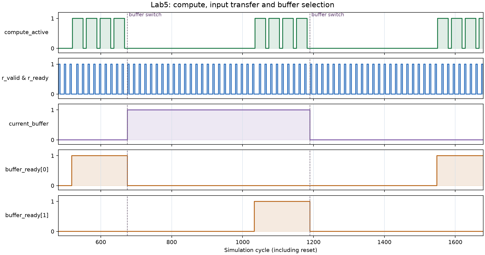

# 分块、双缓冲与周期

## 1. 三种尺寸分别是什么？

| 尺寸 | 含义 | 参数 |
|---|---|---|
| 完整矩阵 | 要计算的 A、B、C 的全局范围。 | `--m`、`--k`、`--n` |
| SPM 中的分块 | 一次加载和保留的局部范围。 | `--tile-m`、`--tile-k`、`--tile-n`，或统一的 `--tile` |
| 物理阵列 | 同时参与流水计算的 PE 行列数。 | `--array` |

例如，一个 32×32 的输出分块可以交给 8×8 阵列分多次处理。阵列大小不需要与分块大小相同，也不等于完整矩阵大小。

构建参数 `--spm-tile` 与 `--spm-k` 决定物理存储容量；运行参数决定这次使用多大的分块。运行分块要在已构建模型的容量内。

## 2. K 维分块为什么需要保留 C？

矩阵乘法沿 K 维累加。当前输出块可写成：

```text
C_block = A_block_0 × B_block_0
        + A_block_1 × B_block_1
        + ……
```

一次 K 分块只产生部分和。本实验把这些部分和累加到 C 的 SPM，直到所有 K 分块完成，才把当前 C 块写回软件 DRAM。

在一个输入块内部，阵列遍历多个 P×P 输出微块，因此已加载的 A、B 数据有机会重复使用。外层切换到其他输出块后，某些全局输入数据还会重新加载。

## 3. 分块改变了哪些数据量？

较大的输入块可能让一次加载的数据参与更多输出计算，减少外层块循环造成的重复加载。另一方面，块必须放进 SPM，块尺寸还会改变微块数量、请求长度和控制过程。

可以从 `read_bytes` 和 `read_requests` 观察输入传输，从 `write_bytes` 和 `write_requests` 观察结果回写。读字节数包含尾拍填充，写字节数根据实际 byte strobe 统计。

这些字段统计模型中的传输，不是电脑运行仿真时实际消耗的内存流量。

## 4. 单缓冲与双缓冲

单缓冲按“加载当前 K 块 → 计算当前 K 块”顺序推进。双缓冲在计算当前 K 块时，把下一 K 块加载到另一个输入缓冲区。

```text
单缓冲：加载 0 → 计算 0 → 加载 1 → 计算 1 → ……

双缓冲：加载 0 → 计算 0 ──────→ 计算 1 ──────→ ……
                 加载 1 ──────→ 加载 2 ──────→ ……
```

阵列开始使用下一缓冲之前，输入数据必须准备好。控制器可以先切换 `current_buffer`，再在 `WAIT_INPUT` 中等待其 `buffer_ready`；若加载能在当前计算期间完成，就有机会隐藏这部分等待。最后的输出写回也需要计入总周期。

!!! tip "比较双缓冲时固定其他条件"
    固定矩阵、阵列、三维分块和 DRAM 参数，只切换 `single` 与 `double`。如果同时把块从 16 改成 64，就无法单独判断缓冲方式贡献了多少变化。

## 5. 周期与利用率

`cycles` 是完成整个任务的硬件周期，包含输入加载、SPM 初始化、阵列计算、填充排空和输出回写。`compute_cycles` 统计阵列推进的周期；`input_wait_cycles` 统计等待当前输入缓冲就绪的周期。

P×P 阵列最多每拍执行 P² 次乘加，因此：

```text
pe_utilization = 有效乘加次数 / (总周期 × P²)
```

`compute_utilization` 则只以阵列推进周期为分母。整体利用率与计算阶段利用率回答不同的问题。

满尺寸 P×P 微块处理一个长度为 TK 的 K 块时，阵列推进包含 TK 的供数以及 `2P−2` 的填充排空距离。查看代码怎样设置运行步数，再考虑不同尺寸下这部分开销的占比。

`overlap_cycles` 统计计算与输入 DMA 同时工作的周期，它是总周期中的一部分，不能与总周期相加。`overlap_read_beats` 帮助观察这段时间里实际接收了多少输入数据。

## 6. 动手试一试

按[操作步骤](run.md)构建后先执行快速验证，再运行完整测量，先固定阵列边长，在不同 tile 下比较单、双缓冲。

### 改变 DRAM 延迟

```bash
for latency in 12 24 48; do
  python3 run.py --m 256 --array 8 --tile 16 32 64 \
    --buffering single double --latency "$latency" \
    --output "results/latency_$latency"
done
```

固定其他条件，观察 `input_wait_cycles`、`cycles` 和 `overlap_read_beats`。延迟改变后，有哪些阶段发生了变化？

### 改变数据拍间隔

```bash
for interval in 1 2 4; do
  python3 run.py --m 256 --array 8 --tile 32 --buffering single double \
    --beat-cycles "$interval" --output "results/beat_$interval"
done
```

这一参数改变连续数据拍之间的最小间隔。比较它与首拍延迟，想一想两者分别影响了突发传输的哪一部分。

### 对照波形与阶段

先生成一个易观察的小配置，固定握手停顿为 0，让两次运行更容易对照：

```bash
python3 run.py --m 32 --k 64 --n 32 --array 8 --tile 16 --buffering double \
  --stall-percent 0 --verify --trace results/buffering.vcd --trace-cycles 4096 \
  --output results/buffering
python3 plot_waveform.py --input results/buffering.vcd --output results/buffering.png
```

先打开生成的 PNG，就能查看关键波形；Windows 的 WSL2 和 macOS 都使用已有的 Python 环境，无需另装查看器。横轴是仿真周期，包含复位阶段。脚本默认选择第一次计算附近的 1200 个周期；可用 `--start 500 --cycles 1500` 改变观察窗口。

[](../assets/lab5-buffering-waveform.png)

点击参考图可查看原图。

这张图来自上面的 32×64×32、8×8 阵列、tile=16 配置。先在 `compute_active=1` 的区间查看 `r_valid & r_ready=1` 的数据拍，确认加载与计算发生重叠；再沿虚线找到 `current_buffer` 的切换，对照下一缓冲的 `buffer_ready`。下一缓冲尚未就绪时，计算仍需要等待。

如果使用 GTKWave 等交互式查看器，按以下步骤查看完整 VCD：

1. 在 Ubuntu 中可执行 `sudo apt install gtkwave`，然后 `gtkwave results/buffering.vcd`；已有查看器的 macOS 同学也可以直接打开此文件。
2. 在层级树中展开 `TOP → matrix_accelerator`。选择 `clk`、`state`、`compute_active`、`current_buffer`、`buffer_ready`、`ar_valid/ready`、`r_valid/ready`，添加到波形列表。
3. 先缩放到完整时间范围，找到第一次 `compute_active=1`，再框选它与首次缓冲切换附近的区间放大。
4. 对多位 `state` 使用十进制显示，按下表识别阶段；若窗口未包含切换，增大 `--trace-cycles` 或调整 `--trace-start` 后重新生成。

| state 值 | 阶段 | 可以观察什么 |
|---|---|---|
| 0 · IDLE | 空闲 | 等待 start |
| 1 · TILE_INIT | 初始化输出块 | 准备分块与读 DMA |
| 2 · ZERO_C | 清零 C 的 SPM | 为跨 K 累加准备空间 |
| 3 · WAIT_INPUT | 等待输入 | 检查当前 buffer_ready |
| 4 · CLEAR_PE | 清零阵列部分和 | 准备下一个微块 |
| 5 · RUN_PE | 推进阵列 | compute_active=1，观察并行的读握手 |
| 6 · STORE_C | 保存本次部分和 | 累加到 C 的 SPM |
| 7 · WRITE_START | 启动写 DMA | 开始输出回写 |
| 8 · WAIT_OUTPUT | 等待输出完成 | aw/w 握手与最后写响应 |

VCD 中每个时钟周期有两个时间 tick；课程脚本换算成周期，并在上升沿之前采样握手。VCD 的 `1ps` 时间单位是仿真表示，不能据此推断真实芯片频率。

??? info "为什么不能用 host_seconds 判断阵列加速？"
    较大的 RTL 模型需要仿真器处理更多逻辑，同一个硬件周期可能花更多宿主机时间。`host_seconds` 反映仿真开销，`cycles` 反映当前设计完成任务的周期数。除非另有时钟频率和实现数据，不能把周期直接当成真实芯片的毫秒或主频性能。

[前往操作步骤](run.md){ .md-button .md-button--primary }
